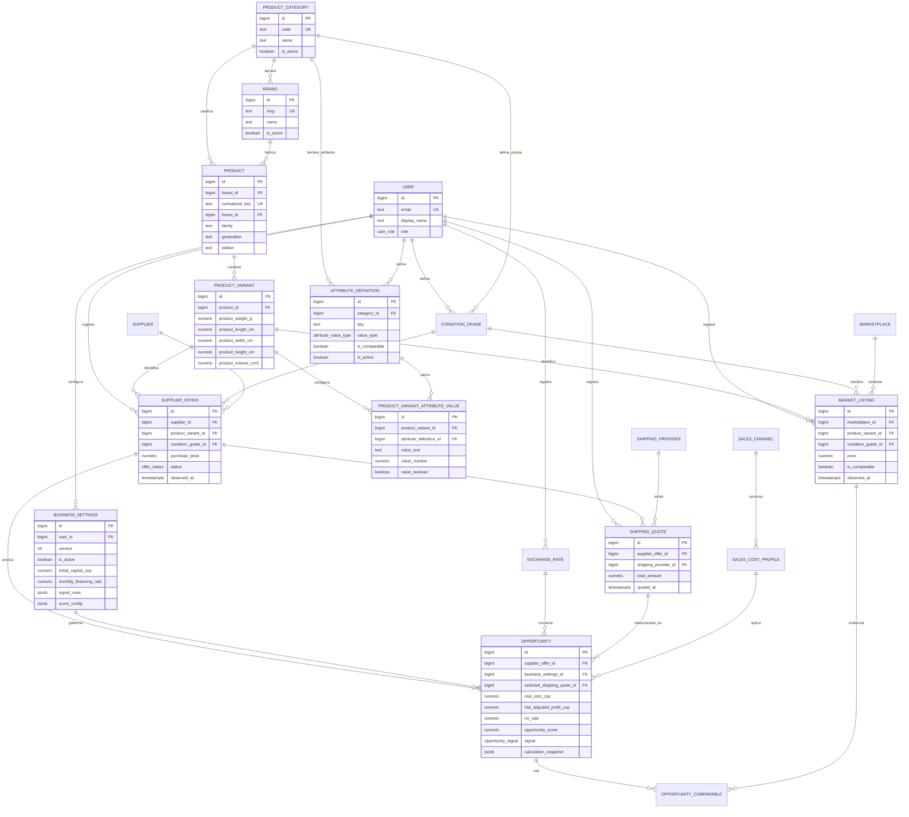

# Modelo de datos — Fase 1

**Estado:** propuesto, pendiente de aprobación  
**Motor objetivo:** PostgreSQL  
**Acceso objetivo:** Prisma ORM 7

> Gate obligatorio: este documento debe ser revisado y aprobado antes de crear `prisma/schema.prisma`, generar SQL o aplicar una migración. A la fecha no se ha generado ni aplicado ninguna migración.

> Actualizado el 2026-10-16 para reflejar el catálogo multiproducto decidido en
> [ADR-0005](../adr/0005-multi-product-catalog.md). Los cambios de diseño que ese ADR
> introduce sobre este documento están marcados como tales.

## Convenciones físicas

- Tablas, columnas, constraints e índices usan nombres `snake_case` en minúsculas.
- Las claves primarias serán `bigint generated ... as identity`; en Prisma se representarán como `BigInt` y en DTOs como strings decimales.
- Se comprobará el DDL generado porque `autoincrement()` debe materializar una estrategia identity adecuada, no asumirse sin revisión.
- Timestamps: `timestamptz`, almacenados en UTC.
- Texto sin límite de negocio real: `text`, no `varchar(255)` arbitrario.
- Dinero y totales: `numeric(20,4)`.
- Tasas, porcentajes y tipos de cambio: `numeric(18,8)`.
- Puntuaciones: `numeric(7,4)` con checks de rango.
- Códigos monetarios: `char(3)` ISO 4217; no enum cerrado.
- Las tasas se almacenan como fracciones, no como porcentajes visuales.
- Todo campo monetario y toda tasa llegan al dominio como Decimal; nunca como `float`, `double precision` o `number` de JavaScript.
- Las FK tienen índice, salvo que ya sean el prefijo izquierdo de un índice compuesto equivalente.
- Las categorías y las marcas son filas de catálogo, no enums: `product_categories` y `brands`.
- Los atributos consultables se almacenan en columnas tipadas (`value_text`, `value_number`, `value_boolean`), y una constraint garantiza que sólo se complete la columna que corresponde al tipo declarado.
- JSON queda reservado para datos externos, snapshots y auditoría; nunca para atributos por los que se filtra o agrupa.
- El peso y las dimensiones de **producto** son datos de variante y provienen de la ficha técnica; el peso y las dimensiones de **paquete** se miden en el envío y nunca se derivan de la ficha.
- Los catálogos o registros referenciados se desactivan; no se eliminan en cascada si destruirían trazabilidad.

Las precisiones propuestas son técnicas, no valores de negocio. Ninguna tasa, costo, umbral o precio predeterminado se define en este documento.

## ERD propuesto

El diagrama muestra relaciones y campos representativos; el diccionario siguiente completa el diseño.

## Diccionario resumido

Todas las tablas incluyen `id`, `created_at` y `updated_at`, salvo las tablas puente. `updated_at` no convierte un registro histórico en mutable: las excepciones se detallan por entidad.

### Identidad y configuración

#### `users`

Identidad local de la persona que opera la aplicación.

- `email`: normalizado y único.
- `display_name`.
- `auth_subject`: identificador opcional y único del proveedor de autenticación.
- `role`: inicialmente `ADMIN`.
- `is_active`.

La autenticación concreta se implementará después del scaffold; no se almacenarán contraseñas en texto ni secretos de sesión en esta tabla.

#### `business_settings`

Snapshot inmutable de la configuración usada por el motor.

- `user_id`, `version`, `is_active`, `effective_at`.
- `initial_capital_cop`, `available_capital_cop`, `financed_principal_cop`.
- `monthly_financing_rate`, `financing_days_per_month`.
- `minimum_profit_cop`, `minimum_roi_rate`, `target_monthly_sales`.
- `cash_reserve_rate`, `warranty_reserve_rate`, `warranty_reserve_basis`.
- `fx_spread_rate`, `safety_margin_rate`.
- `default_expected_days_to_sell`, `max_capital_per_product_rate`.
- `conservative_price_strategy`, `conservative_price_parameter`.
- `signal_rules`: JSONB versionado y validado con Zod para los umbrales ordenados de cada señal.
- `score_config`: JSONB versionado y validado con Zod para factores, pesos y curvas deterministas.
- `calculation_policy_version`, `score_policy_version`.

Una modificación crea una fila con una versión nueva y desactiva la anterior dentro de una transacción. Nunca altera los settings vinculados a una oportunidad existente. Los JSONB se usan porque son políticas versionadas y evolutivas; no sustituyen columnas monetarias consultables.

#### `condition_grades`

Clasificación configurable; no se implementa como enum PostgreSQL.

- `user_id`, `category_id`, `code`, `label`, `rank`, `score_value`, `is_active`.

La escala de condición pertenece a la categoría: un teléfono y una consola no
comparten graduación. `rank` y `score_value` se interpretan dentro de la categoría y
sólo dentro de ella.

Los códigos iniciales podrán corresponder a la taxonomía aprobada por el usuario, pero el seed no asignará tasas, costos ni puntuaciones no confirmadas.

### Catálogo

Los nombres físicos de este documento son los de la tabla. Su correspondencia
con los modelos del ORM es la de [ADR-0005](../adr/0005-multi-product-catalog.md):

| Modelo | Tabla | Papel en el catálogo |
| --- | --- | --- |
| `ProductCategory` | `product_categories` | Fila administrable; sustituye al enum implícito de categoría |
| `Brand` | `brands` | Fila administrable; sustituye al texto de marca |
| `Product` | `products` | Modelo comercial; referencia marca y familia |
| `ProductVariant` | `product_variants` | Configuración vendible; aloja peso y dimensiones de producto |
| `AttributeDefinition` | `attribute_definitions` | Declara un atributo, su tipo y si es comparable |
| `ProductVariantAttributeValue` | `product_variant_attribute_values` | Valor tipado del atributo para una variante |
| `ProductVariantExternalIdentifier` | `product_variant_external_identifiers` | Identificador comercial observado en una fuente externa, pendiente de promover |

#### `product_categories`

Categoría de producto administrable. **No es un enum.**

- `code`: clave estable y única, por ejemplo `SMARTPHONE`, `CONSOLE`.
- `name`, `sort_order` opcional, `is_active`.

Una categoría nueva es una fila y una carga de `attribute_definitions`; no requiere
migración.

#### `brands`

Marca administrable. **No es un enum.**

- `slug`: clave única y estable.
- `name`, `is_active`.

#### `attribute_definitions`

Definición de un atributo consultable de variante.

- `category_id`, `key`, `label`.
- `value_type`: `TEXT`, `NUMBER` o `BOOLEAN`. Determina qué columna se completa.
- `is_comparable`: si el atributo participa en la huella de comparables.
- `is_required` opcional, `unit` opcional, `is_active`.

#### `product_variant_attribute_values`

Valor de un atributo para una variante, con columnas tipadas.

- `product_variant_id`, `attribute_definition_id`, únicos juntos.
- `value_text`, `value_number`, `value_boolean`: exactamente una informada según `value_type`.

Una constraint posterior impedirá completar dos columnas o la columna equivocada.

#### `products`

Modelo comercial independiente de almacenamiento y color.

- `normalized_key`: clave canónica única.
- `brand_id`: referencia a `brands`. **Sustituye** a la marca como texto, conforme a ADR-0005.
- `display_name`.
- `family`, `generation` y `edition` dejan de ser columnas y pasan a `attribute_definitions`; la edición afecta a la variante vendible, no al modelo comercial.
- `release_year` opcional, `is_active`.

Ejemplo conceptual: familia iPhone, generación 15, edición Pro Max. El texto de una publicación nunca sustituye esta relación normalizada.

#### `product_variants`

SKU normalizado comparable.

- `product_id`, `storage_gb`.
- `color_key`, `color_label`, `region_code` y `sim_type` dejan de ser columnas y pasan a atributos tipados: son configuraciones de la variante, no del texto de la publicación.
- `gtin`: identificador comercial canónico, opcional, sólo dígitos. Es el único almacenado de la familia GS1: UPC-12, EAN-13 y EAN-8 se derivan de él por longitud (ADR-0005). `NULL` es un estado legítimo.
- `manufacturer_part_number`: opcional. Espacio de nombres distinto del GTIN, por eso tiene columna propia.
- `product_weight_g`, `product_length_cm`, `product_width_cm`, `product_height_cm` y `product_volume_cm3`, todos opcionales y positivos cuando están. Peso y dimensiones **de producto**, desde la ficha técnica.
- El peso de la ficha técnica **no** es el peso facturable: el peso del paquete se mide en el envío y se registra con la logística.
- `manufacturer_sku` opcional, `is_active`.

Ningún identificador comercial es la clave primaria: la PK sigue siendo `id`.

#### `product_variant_external_identifiers`

Identificador comercial **observado** en una fuente externa, pendiente o no de
promover al catálogo maestro (M6).

- `product_variant_id` opcional: `NULL` mientras no se promueve. Una observación sin
  confirmar no tiene variante.
- `identifier_type`, `identifier_value` (valor crudo tal como lo publicó la fuente),
  `normalized_value` (sólo para la familia GTIN), `source_key`, `source_kind`,
  `external_listing_key` opcional.
- `supplier_offer_id` y `market_listing_id` opcionales: de qué registro proviene la
  observación.
- `promotion_status` (`OBSERVED`, `CONFIRMED`, `REJECTED`), `promoted_at` y
  `reviewed_by_user_id` opcionales.

No es un MDM: no hay reglas de fusión, ni cola de trabajo, ni resolución de
duplicados. Sólo observación, evidencia y promoción.

Carrier, condición, batería y bloqueos pertenecen a la oferta observada, no al SKU.

### Fuentes de compra y mercado

#### `suppliers`

- `name`, `slug`, `country_code`, `website_url`.
- `connector_key`, `integration_mode`, `is_active`.

`connector_key` identifica un adaptador; no contiene credenciales.

#### `supplier_offers`

Oferta observada para comprar una variante.

- `created_by_user_id`, `supplier_id`, `product_variant_id`, `condition_grade_id`.
- `external_id` opcional, `source_url`, `raw_title`.
- `currency_code`, `purchase_price`, `us_shipping`, `us_sales_tax`, `payment_fee`, `other_purchase_cost`.
- `available_quantity` opcional, `status`, `observed_at`, `expires_at` opcional.
- calidad: `battery_health_percent`, `screen_authenticity`, `battery_authenticity`, `face_id_state`, `true_tone_state`, `cameras_state`, `imei_status`, `carrier_lock_status`, `icloud_status`.
- `dents_notes`, `scratches_notes`, `supplier_warranty_days`.
- `seller_reputation_rate`, `seller_review_count` opcionales.

Una ausencia se representa como `NULL` o `UNKNOWN`, nunca como una condición favorable asumida.

#### `marketplaces`

- `name`, `slug`, `country_code`, `website_url`.
- `connector_key`, `integration_mode`, `is_active`.

#### `market_listings`

Comparable observado en el mercado colombiano.

- `created_by_user_id`, `marketplace_id`, `product_variant_id`, `condition_grade_id`.
- `external_id` opcional, `source_url`, `raw_title`.
- `currency_code`, `price`, `status`, `observed_at`, `expires_at` opcional.
- subconjunto de calidad equivalente al de `supplier_offers` cuando la fuente lo informa.
- `seller_name`, `seller_reputation_rate`, `location` opcionales.
- `is_comparable`, `exclusion_reason` opcional.

En Fase 1 la corrección de una entrada manual puede actualizar el listing, pero las oportunidades ya calculadas conservan el precio y los atributos aplicados en su snapshot.

### Envío, cambio y venta

#### `shipping_providers`

- `name`, `slug`, `website_url`.
- `connector_key`, `integration_mode`, `is_active`.

#### `shipping_quotes`

Cotización para una oferta concreta.

- `created_by_user_id`, `supplier_offer_id`, `shipping_provider_id`.
- `currency_code`, `item_weight_lb` opcional.
- componentes: `international_shipping`, `handling`, `insurance`, `customs`, `tariff`, `vat`, `fuel_surcharge`, `logistics`, `nationalization`, `local_delivery`, `other_cost`.
- `total_amount`, `quoted_at`, `expires_at` opcional, `notes`.

Todos los componentes de una cotización comparten moneda. En Fase 1, el flujo exigirá costos normalizados a COP antes del análisis; el valor original puede preservarse en notas o metadatos de importación futuros. `total_amount` debe ser exactamente la suma de sus componentes.

#### `exchange_rates`

- `created_by_user_id` opcional para fuentes automáticas.
- `base_currency_code`, `quote_currency_code`, `rate`.
- `source`, `provider_name` opcional, `observed_at`, `notes`.

La fila contiene la tasa base observada. El spread aplicado pertenece a la versión de `business_settings`; la oportunidad guarda ambos valores para evitar doble conteo.

#### `sales_channels`

- `code`, `name`, `is_active`.

#### `sales_cost_profiles`

Política versionada de costos de un canal.

- `sales_channel_id`, `version`, `valid_from`, `valid_to` opcional.
- `selling_fee_rate`, `withholding_rate`.
- `fixed_fee_cop`, `shipping_cost_cop`, `advertising_cost_cop`, `other_cost_cop`.

No se suministran defaults. Cada perfil debe ser ingresado o aprobado explícitamente.

### Análisis de oportunidad

#### `opportunities`

Resultado inmutable y auditable de ejecutar el motor sobre un conjunto de entradas.

- referencias: `supplier_offer_id`, `business_settings_id`, `exchange_rate_id`, `selected_shipping_quote_id`, `sales_cost_profile_id`.
- control: `analysis_version`, `calculation_policy_version`, `score_policy_version`, `analyzed_at`, `expires_at`, `status`, `supersedes_opportunity_id` opcional.
- mercado: `market_sample_count`, `market_min_cop`, `market_average_cop`, `market_median_cop`, `market_max_cop`, `conservative_sale_price_cop`.
- conversión y costo: `exchange_rate_applied`, `fx_spread_rate_applied`, `product_cost_cop`, `landed_cost_cop`, `selling_costs_cop`, `warranty_reserve_cop`, `financing_cost_cop`, `other_costs_cop`, `real_cost_cop`, `capital_required_cop`.
- retorno: `gross_profit_cop`, `risk_adjusted_profit_cop`, `margin_rate`, `roi_rate`, `monthly_equivalent_roi_rate`, `annualized_roi_rate`.
- evaluación: `expected_days_to_sell`, `capital_velocity_score`, `opportunity_score`, `signal`.
- auditoría: `calculation_snapshot`, `score_breakdown`, `risk_flags` en JSONB con esquema versionado.

Una reevaluación crea otra fila y enlaza opcionalmente la anterior mediante `supersedes_opportunity_id`. Los JSONB permiten explicar el cálculo exacto, pero los resultados usados en filtros del dashboard también son columnas tipadas.

#### `opportunity_comparables`

Tabla puente entre una oportunidad y los listings examinados.

- PK compuesta: `opportunity_id`, `market_listing_id`.
- `included`, `exclusion_reason`.
- `price_at_analysis_cop`, `condition_code_at_analysis`.

Conserva evidencia explícita de qué publicaciones participaron en las estadísticas.

## Enums conceptuales

Sólo los estados de ciclo de vida estables se consideran enums. La traducción final a enums PostgreSQL o texto con `CHECK` se decidirá al revisar el esquema Prisma.

- `AttributeValueType`: `TEXT`, `NUMBER`, `BOOLEAN`. Determina la columna a completar.
- `UserRole`: `ADMIN`.
- `IntegrationMode`: `MANUAL`, `API`, `FEED`, `CSV`.
- `OfferStatus`: `ACTIVE`, `INACTIVE`, `SOLD_OUT`, `EXPIRED`.
- `ListingStatus`: `ACTIVE`, `INACTIVE`, `REMOVED`, `EXPIRED`.
- `SimType` deja de ser enum y pasa a atributo tipado de la variante, conforme a ADR-0005.
- `PartAuthenticity`: `ORIGINAL`, `REPLACED_OEM`, `REPLACED_THIRD_PARTY`, `UNKNOWN`.
- `FeatureState`: `PASS`, `FAIL`, `UNKNOWN`, `NOT_APPLICABLE`.
- `ImeiStatus`: `CLEAN`, `BLOCKED`, `UNKNOWN`.
- `CarrierLockStatus`: `UNLOCKED`, `LOCKED`, `UNKNOWN`.
- `IcloudStatus`: `CLEAR`, `LOCKED`, `UNKNOWN`.
- `WarrantyReserveBasis`: `LANDED_COST`, `SALE_PRICE`.
- `ConservativePriceStrategy`: `MEDIAN_DISCOUNT`, `PERCENTILE`, `MINIMUM`.
- `ExchangeRateSource`: `MANUAL`, `AUTOMATIC`.
- `OpportunitySignal`: `STRONG_BUY`, `BUY`, `WATCH`, `REJECT`.
- `OpportunityStatus`: `ACTIVE`, `EXPIRED`, `DISMISSED`, `PURCHASED`.

`ConditionGrade`, reglas de señal, pesos del score, monedas, tasas e importes no son enums ni constantes de código.

## Índices propuestos

PostgreSQL no crea índices para FK automáticamente. La migración deberá verificar cobertura de todas las FK y evitar índices redundantes.

### Unicidad

- `users (lower(email))` único.
- `users (auth_subject)` único parcial cuando no sea nulo.
- `business_settings (user_id, version)` único.
- `business_settings (user_id)` único parcial `WHERE is_active`.
- `condition_grades (user_id, code)` único.
- `product_categories (code)` único.
- `brands (slug)` único.
- `products (normalized_key)` único.
- `attribute_definitions (category_id, key)` único.
- `product_variant_attribute_values (product_variant_id, attribute_definition_id)` único.
- `condition_grades (user_id, category_id, code)` único: la escala es por categoría.
- La unicidad de variante se determina por sus **atributos**, no por columnas: la clave canónica se deriva de `variant_key` calculada a partir del producto y de los valores de atributos. La unicidad anterior por columnas deja de aplicar al migrar el catálogo.
- `suppliers (slug)`, `marketplaces (slug)`, `shipping_providers (slug)` y `sales_channels (code)` únicos.
- `supplier_offers (supplier_id, external_id)` único parcial cuando `external_id` no sea nulo.
- `market_listings (marketplace_id, external_id)` único parcial cuando `external_id` no sea nulo.
- `sales_cost_profiles (sales_channel_id, version)` único.
- `sales_cost_profiles (sales_channel_id)` único parcial `WHERE valid_to IS NULL`.

### Catálogo y atributos

- Variantes por producto: `(product_id, is_active)`.
- Valores de atributo por tipo, para comparar sin escaneo secuencial:
  `(attribute_definition_id, value_number)`, `(attribute_definition_id, value_text)` y
  `(attribute_definition_id, value_boolean)`.
- Atributos comparables de una variante: `(product_variant_id, attribute_definition_id)` con filtro por `attribute_definitions.is_comparable`.
- Grados de condición por categoría: `(category_id, user_id, rank)`.

### Lecturas principales

- Ofertas: `(product_variant_id, status, observed_at DESC, id DESC)`.
- Ofertas por proveedor: `(supplier_id, status, observed_at DESC, id DESC)`.
- Comparables: `(product_variant_id, status, observed_at DESC, id DESC)`.
- Comparables por condición: `(product_variant_id, condition_grade_id, status, observed_at DESC)`.
- Cotizaciones vigentes de una oferta: `(supplier_offer_id, quoted_at DESC, id DESC)`.
- Cotizaciones por operador: `(shipping_provider_id, quoted_at DESC, id DESC)`.
- Tasa más reciente: `(base_currency_code, quote_currency_code, observed_at DESC, id DESC)`.
- Historial de análisis: `(supplier_offer_id, analyzed_at DESC, id DESC)`.
- Dashboard: índice parcial `(opportunity_score DESC, analyzed_at DESC, id DESC) WHERE status = 'ACTIVE'`.
- Señales activas: índice parcial `(signal, opportunity_score DESC, id DESC) WHERE status = 'ACTIVE'`.
- `opportunity_comparables (market_listing_id)` además de su PK compuesta.

El orden coloca filtros de igualdad antes que rangos y ordenamientos. La paginación será por cursor usando las columnas del orden más `id` como desempate. No se crearán índices GIN sobre JSONB hasta existir una consulta y un plan que los justifiquen.

## Invariantes y constraints

- Importes, costos, cantidades, pesos, días y conteos no pueden ser negativos.
- Un valor de atributo completa exactamente una columna, y es la que corresponde a `attribute_definitions.value_type`.
- El peso y las dimensiones de producto son positivos cuando están informados.
- El peso del paquete se mide; no se copia de la ficha técnica del producto.
- La comparación de precios exige coincidencia de categoría, variante y atributos marcados como comparables. El color no es comparable por definición.
- Los atributos numéricos obligatorios, `financing_days_per_month` y los días esperados deben ser mayores que cero cuando estén informados.
- Tasas configurables, margen y ROI sujetos a dominio acotado deben cumplir el rango definido por el contrato de cada campo; porcentajes de reserva, spread y concentración deben estar entre cero y uno.
- `battery_health_percent`, reputación normalizada, score de condición y score de oportunidad están entre cero y cien.
- Los códigos monetarios tienen tres letras mayúsculas y base y cotizada no pueden ser iguales.
- `gtin`, cuando existe, contiene sólo dígitos y tiene 8, 12, 13 o 14 cifras. Ningún flujo puede exigir que exista.
- Un identificador observado sólo escribe identidad canónica cuando su estado es `CONFIRMED` y entonces tiene variante y fecha de promoción.
- `normalized_value` sólo existe para la familia GTIN: un MPN normalizado contaminaría el matching por GTIN.
- `expires_at`, cuando exista, es posterior a `observed_at` o `quoted_at`.
- `shipping_quotes.total_amount` es la suma exacta de sus componentes en la misma moneda.
- Sólo existe una versión activa de settings por usuario y un perfil vigente por canal.
- Una oportunidad referencia una cotización de la misma oferta analizada.
- La cotización seleccionada está expresada en COP antes del cálculo de Fase 1.
- El orden y la estructura de `signal_rules` y `score_config` se validan con Zod antes de persistir y nuevamente al ejecutar el motor.
- No se puede clasificar una oportunidad como completa si faltan insumos obligatorios; debe fallar con error de dominio o quedar marcada con un riesgo explícito, nunca completar valores desconocidos con cero silenciosamente.
- Los registros usados por una oportunidad no se eliminan físicamente.

Las constraints que Prisma no pueda expresar se añadirán únicamente al SQL de una migración creada en modo `create-only`, después de revisar nombres y compatibilidad. No se intentará usar `ADD CONSTRAINT IF NOT EXISTS`, sintaxis que PostgreSQL no soporta.

## Entidades diferidas

Estas entidades aparecen en la visión del producto, pero no deben crear tablas en Fase 1:

- `Watchlist` y `PriceSnapshot`;
- `InventoryItem`, incluida la protección del IMEI;
- `Sale`, `Expense` y `CapitalTransaction`;
- `Alert` y sus entregas;
- ejecuciones y resultados del optimizador de capital.

El snapshot dentro de `opportunities` resuelve la auditoría inmediata del cálculo, pero no reemplaza el historial general de precios previsto para una fase posterior.

Las dimensiones y el peso de **paquete** quedan fuera de Fase 1: se capturan con la
logística de casillero y con la cotización. Lo que sí queda en Fase 1 es la
distinción documentada entre el peso de producto (ficha técnica, en la variante) y el
peso de paquete (medido, en el envío), para que ninguno se reutilice por error.

La Fase A de compras amplía este modelo con `purchases`, `purchase_events` y
`shipments`, documentadas en
[purchases-fiscal-phase-a-design.md](./purchases-fiscal-phase-a-design.md). Las
compras referencian únicamente `product_variant_id`: no tienen columnas de marca,
categoría ni modelo, y por eso siguen siendo genéricas entre categorías.

**PS5 como segundo caso de validación.** La consola obliga a comprobar que
capacidad y edición conviven como atributos de la misma variante, que no hay
supuestos de operador móvil ni de salud de batería, y que el Opportunity Engine
calcula la oportunidad sin bifurcarse por categoría.

## Preguntas de aprobación

Antes de traducir este documento a Prisma deben confirmarse:

1. ~~Si color y región forman parte obligatoria de toda variante~~ Resuelto por ADR-0005: ambos son atributos tipados; el color se declara no comparable y la región comparable sólo si el negocio lo confirma.
2. Qué estrategias de precio conservador estarán habilitadas inicialmente y qué parámetro exige cada una.
3. Si los costos de casillero se ingresarán exclusivamente en COP durante el MVP.
4. Qué campos de calidad son obligatorios para considerar dos equipos comparables.
5. Si el ROI mostrado usa `risk_adjusted_profit_cop` como numerador; ésta es la propuesta para evitar presentar retorno antes de reservas y financiación.
6. Qué convención se usará para ROI mensual/anualizado y cómo se mostrará cuando el período esperado sea cero o incompleto.

7. En qué unidad se expresa el peso de producto: hoy la variante usa gramos y el envío libras. Conviene fijar una convención única antes de la migración.
8. ~~Dónde vive el identificador de búsqueda por código (GTIN, UPC o EAN)~~ Resuelto por M6: `product_variants.gtin` (canónico, opcional) y `manufacturer_part_number`. UPC y EAN se derivan de `gtin` por longitud; lo observado en cada fuente vive en `product_variant_external_identifiers` hasta su promoción. Ver [prisma-manual-sql-catalog.md](./prisma-manual-sql-catalog.md).

Ninguna respuesta se sustituirá por una tasa o costo supuesto.
