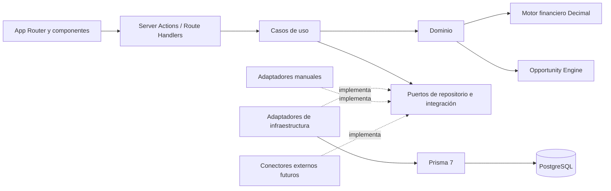

# Arquitectura de ReventaIQ

**Estado:** propuesta para aprobación  
**Alcance:** Fase 1 / MVP privado  
**Última actualización:** 2026-10-16

> Esta documentación no autoriza cambios en la base de datos. A la fecha no se ha generado ni aplicado ninguna migración. El modelo de datos debe aprobarse antes de crear `schema.prisma` o ejecutar comandos de migración.

## Objetivo

ReventaIQ será un escáner de oportunidades de compra y reventa de iPhone entre Estados Unidos y Colombia. La Fase 1 debe validar las fórmulas y la lógica del negocio con datos ingresados manualmente, manteniendo trazabilidad completa de cada análisis.

La arquitectura se plantea como un monolito modular en Next.js App Router. Esto mantiene bajo el costo operativo del MVP, pero separa presentación, casos de uso, dominio, persistencia e integraciones para que cada área pueda evolucionar sin mezclar responsabilidades.

## Alcance del MVP

Incluye:

- configuración versionada del negocio;
- catálogo normalizado de iPhone y variantes;
- ingreso manual de ofertas de compra en Estados Unidos;
- ingreso manual de comparables de venta en Colombia;
- ingreso manual de tasas de cambio, costos por canal y cotizaciones de casillero;
- motor financiero determinista con aritmética Decimal;
- Opportunity Engine con precio conservador, mejor alternativa de envío, score y señal;
- dashboard de oportunidades;
- detalle de oportunidad con desglose y evidencia de cálculo;
- un único usuario administrador, dejando preparada la frontera de autenticación.

Quedan fuera de la Fase 1:

- scraping o conectores automáticos;
- alertas externas;
- watchlists automáticas e historial general de precios;
- inventario, ventas, gastos y libro de capital;
- optimizador de portafolio;
- analytics avanzados;
- multiusuario, suscripciones y funciones SaaS.

## Principios

1. La lógica financiera no vive en componentes React, acciones de servidor ni repositorios.
2. Todo importe, tasa o umbral de negocio proviene de datos configurados; no se inventan ni se codifican constantes financieras.
3. Los cálculos monetarios usan precisión decimal exacta de extremo a extremo.
4. Cada análisis conserva las entradas, la versión de configuración y la versión del algoritmo que lo produjeron.
5. Los registros externos incluyen fuente, URL y momento de observación.
6. La entrada manual implementa los mismos contratos que usarán los conectores futuros.
7. Los límites de módulo se respetan dentro del monolito; ningún módulo consulta tablas de otro módulo de forma ad hoc.
8. Las tablas y columnas físicas usan `snake_case`; TypeScript puede usar `camelCase` mediante el mapeo del ORM.

## Vista lógica



Las dependencias apuntan hacia el dominio. El dominio no importa React, Next.js, Prisma ni SDKs externos.

## Módulos

| Módulo | Responsabilidad | No debe conocer |
| --- | --- | --- |
| `catalog` | Productos, variantes y grados de condición | Costos y UI |
| `settings` | Parámetros versionados, reglas de señal y score | Prisma fuera de su repositorio |
| `suppliers` | Proveedores y ofertas USA | Estadísticas de mercado |
| `market` | Marketplaces y comparables Colombia | Fórmulas financieras |
| `shipping` | Proveedores y cotizaciones de envío | Selección final de oportunidad |
| `exchange-rates` | Tasas observadas y origen de la tasa | Spread configurado del negocio |
| `sales-channels` | Perfiles versionados de costos por canal | Ventas reales futuras |
| `finance` | Value objects y funciones financieras puras | Framework, red y base de datos |
| `opportunities` | Orquestación, comparables, score, señal y snapshots | Detalles de acceso físico a datos |

## Estructura objetivo

```text
src/
  app/
    (app)/
      dashboard/
      opportunities/[id]/
      data-entry/
        offers/
        market-listings/
        shipping-quotes/
      settings/
    api/                         # integraciones futuras, imports y webhooks
  components/
    ui/
    layout/
  modules/
    catalog/
    settings/
    suppliers/
    market/
    shipping/
    exchange-rates/
    sales-channels/
    finance/
    opportunities/
  connectors/
    contracts/
    manual/
  db/
    prisma.ts
    transaction.ts
  lib/
    auth/
    decimal/
    env.ts
    errors/
prisma/
  schema.prisma
  migrations/
  seed.ts
tests/
  integration/
  e2e/
docs/
  architecture/
  adr/
```

Cada módulo puede contener:

```text
domain/          # entidades, value objects, políticas y funciones puras
application/     # comandos, consultas, DTOs y puertos
infrastructure/  # repositorios Prisma y adaptadores
ui/              # componentes específicos del módulo, si son necesarios
```

No se crearán carpetas vacías para conectores que todavía no existan.

## Flujo de una solicitud

1. Un Server Component solicita un DTO a un caso de uso de consulta.
2. Un formulario invoca una Server Action; la entrada se valida con Zod.
3. El caso de uso obtiene datos mediante puertos, ejecuta el dominio y persiste en una transacción cuando corresponde.
4. Los repositorios adaptan entre modelos Prisma y tipos del dominio.
5. Los valores `Decimal`, `bigint` y fechas se serializan explícitamente antes de cruzar hacia Client Components.
6. La UI formatea moneda y porcentajes, pero nunca recalcula resultados financieros.

Los Route Handlers se reservan para fronteras HTTP reales: imports, webhooks o APIs de conectores. No se agregará una API interna innecesaria entre Server Components y los casos de uso.

## Contratos de integración

Los conectores futuros deben depender de contratos estables, por ejemplo:

- `SupplierOfferSource` entrega ofertas externas normalizadas;
- `MarketListingSource` entrega observaciones de mercado normalizadas;
- `ShippingQuoteSource` entrega cotizaciones con componentes explícitos;
- `ExchangeRateSource` entrega una tasa, fuente y momento de observación.

El adaptador `manual` produce los mismos DTOs. Ningún conector puede escribir directamente en las tablas ni devolver modelos específicos de su proveedor al dominio.

No se implementará un conector sin confirmar una API, feed, archivo autorizado o permiso de uso. Las credenciales viven en variables de entorno o en un almacén de secretos, nunca en el repositorio.

## Operación y seguridad

- Prisma usa una única instancia reutilizable durante desarrollo y conexiones agrupadas en despliegues con alta concurrencia.
- La conexión usada por la aplicación no debe tener privilegios de propietario del esquema.
- La URL de migración y la URL de ejecución se separarán si el proveedor de PostgreSQL lo requiere.
- Los datos sensibles futuros, especialmente IMEI e información de clientes, requieren cifrado o protección equivalente, enmascarado y autorización explícita antes de incorporar inventario y ventas.
- Los errores internos no se muestran directamente al usuario; cada operación debe dejar contexto técnico trazable sin registrar secretos.
- La zona horaria se conserva en UTC mediante `timestamptz`; `America/Bogota` se usa sólo para presentación y reglas que explícitamente lo requieran.

## Criterio de salida de Fase 1

La Fase 1 queda validada cuando un administrador puede ingresar manualmente todos los insumos, obtener un análisis reproducible, inspeccionar su desglose, comparar oportunidades en el dashboard y confirmar mediante pruebas que los resultados no cambian por redondeos binarios ni por modificaciones posteriores de configuración.

Los detalles del esquema están en [data-model-phase-1.md](./data-model-phase-1.md) y la secuencia de entrega en [implementation-plan.md](./implementation-plan.md).
