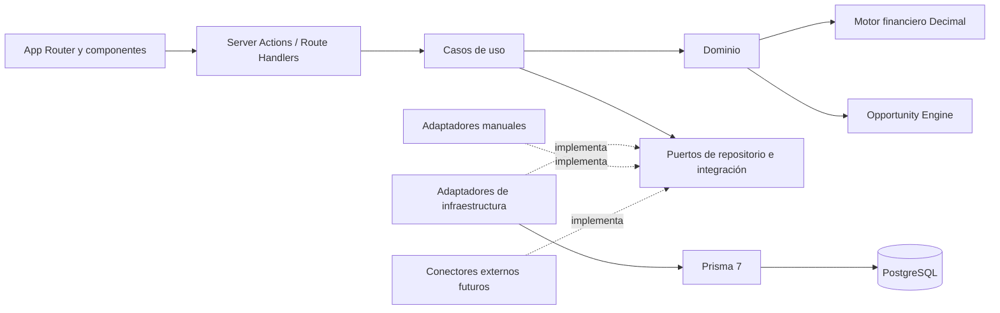

# Arquitectura de ReventaIQ

**Estado:** propuesta para aprobación  
**Alcance:** Fase 1 / MVP privado  
**Última actualización:** 2026-10-16

> Esta documentación no autoriza cambios en la base de datos. A la fecha no se ha generado ni aplicado ninguna migración. El modelo de datos debe aprobarse antes de crear `schema.prisma` o ejecutar comandos de migración.

## Objetivo

ReventaIQ será un escáner de oportunidades de compra y reventa de productos de segunda mano entre Estados Unidos y Colombia. La Fase 1 debe validar las fórmulas y la lógica del negocio con datos ingresados manualmente, manteniendo trazabilidad completa de cada análisis.

El dominio es **multiproducto desde el catálogo**, no desde el motor: iPhone es la primera categoría (`SMARTPHONE`) y una consola es el caso de validación de la segunda. El motor financiero y el Opportunity Engine son **únicos** y no se bifurcan por categoría; lo que varía es el catálogo que los alimenta. Ver [ADR-0005](../adr/0005-multi-product-catalog.md).

La arquitectura se plantea como un monolito modular en Next.js App Router. Esto mantiene bajo el costo operativo del MVP, pero separa presentación, casos de uso, dominio, persistencia e integraciones para que cada área pueda evolucionar sin mezclar responsabilidades.

## Alcance del MVP

Incluye:

- configuración versionada del negocio;
- catálogo administrable de productos y variantes, con categorías, marcas y atributos tipados;
- ingreso manual de ofertas de compra en Estados Unidos;
- ingreso manual de comparables de venta en Colombia;
- ingreso manual de tasas de cambio, costos por canal y cotizaciones de casillero;
- motor financiero determinista con aritmética Decimal;
- Opportunity Engine con precio conservador, mejor alternativa de envío, score y señal;
- dashboard de oportunidades;
- detalle de oportunidad con desglose y evidencia de cálculo;
- un único usuario administrador, dejando preparada la frontera de autenticación.

Quedan fuera de la Fase 1:

- scraping o conectores automáticos;
- alertas externas;
- watchlists automáticas e historial general de precios;
- inventario, ventas, gastos y libro de capital;
- peso y dimensiones de paquete, que quedan preparadas pero se capturan junto con la logística;
- optimizador de portafolio;
- analytics avanzados;
- multiusuario, suscripciones y funciones SaaS.

## Principios

1. La lógica financiera no vive en componentes React, acciones de servidor ni repositorios.
2. Todo importe, tasa o umbral de negocio proviene de datos configurados; no se inventan ni se codifican constantes financieras.
3. Los cálculos monetarios usan precisión decimal exacta de extremo a extremo.
4. Cada análisis conserva las entradas, la versión de configuración y la versión del algoritmo que lo produjeron.
5. Los registros externos incluyen fuente, URL y momento de observación.
6. La entrada manual implementa los mismos contratos que usarán los conectores futuros.
7. Los límites de módulo se respetan dentro del monolito; ningún módulo consulta tablas de otro módulo de forma ad hoc.
8. Las tablas y columnas físicas usan `snake_case`; TypeScript puede usar `camelCase` mediante el mapeo del ORM.
9. El motor financiero y el Opportunity Engine son únicos. Ninguna categoría de producto tiene motor, reglas ni tablas propias: el multiproducto se resuelve en el catálogo.
10. Las categorías, marcas y atributos son datos administrables, no enums de código. Una categoría nueva se agrega con filas, sin migración.

## Vista lógica



Las dependencias apuntan hacia el dominio. El dominio no importa React, Next.js, Prisma ni SDKs externos.

## Módulos

| Módulo | Responsabilidad | No debe conocer |
| --- | --- | --- |
| `catalog` | Categorías, marcas, productos, variantes, atributos tipados y grados de condición | Costos, logística y UI |
| `settings` | Parámetros versionados, reglas de señal y score | Prisma fuera de su repositorio |
| `suppliers` | Proveedores y ofertas USA | Estadísticas de mercado |
| `market` | Marketplaces y comparables Colombia | Fórmulas financieras |
| `shipping` | Proveedores y cotizaciones de envío | Selección final de oportunidad |
| `exchange-rates` | Tasas observadas y origen de la tasa | Spread configurado del negocio |
| `sales-channels` | Perfiles versionados de costos por canal | Ventas reales futuras |
| `finance` | Value objects y funciones financieras puras | Framework, red y base de datos |
| `opportunities` | Orquestación, comparables, score, señal y snapshots | Detalles de acceso físico a datos |

## Estructura objetivo

```text
src/
  app/
    (app)/
      dashboard/
      opportunities/[id]/
      data-entry/
        offers/
        market-listings/
        shipping-quotes/
      settings/
    api/                         # integraciones futuras, imports y webhooks
  components/
    ui/
    layout/
  modules/
    catalog/
    settings/
    suppliers/
    market/
    shipping/
    exchange-rates/
    sales-channels/
    finance/
    opportunities/
  connectors/
    contracts/
    manual/
  db/
    prisma.ts
    transaction.ts
  lib/
    auth/
    decimal/
    env.ts
    errors/
prisma/
  schema.prisma
  migrations/
  seed.ts
tests/
  integration/
  e2e/
docs/
  architecture/
  adr/
```

Cada módulo puede contener:

```text
domain/          # entidades, value objects, políticas y funciones puras
application/     # comandos, consultas, DTOs y puertos
infrastructure/  # repositorios Prisma y adaptadores
ui/              # componentes específicos del módulo, si son necesarios
```

No se crearán carpetas vacías para conectores que todavía no existan.

## Flujo de una solicitud

1. Un Server Component solicita un DTO a un caso de uso de consulta.
2. Un formulario invoca una Server Action; la entrada se valida con Zod.
3. El caso de uso obtiene datos mediante puertos, ejecuta el dominio y persiste en una transacción cuando corresponde.
4. Los repositorios adaptan entre modelos Prisma y tipos del dominio.
5. Los valores `Decimal`, `bigint` y fechas se serializan explícitamente antes de cruzar hacia Client Components.
6. La UI formatea moneda y porcentajes, pero nunca recalcula resultados financieros.

Los Route Handlers se reservan para fronteras HTTP reales: imports, webhooks o APIs de conectores. No se agregará una API interna innecesaria entre Server Components y los casos de uso.

## Contratos de integración

Los conectores futuros deben depender de contratos estables, por ejemplo:

- `SupplierOfferSource` entrega ofertas externas normalizadas;
- `MarketListingSource` entrega observaciones de mercado normalizadas;
- `ShippingQuoteSource` entrega cotizaciones con componentes explícitos;
- `ExchangeRateSource` entrega una tasa, fuente y momento de observación.

El adaptador `manual` produce los mismos DTOs. Ningún conector puede escribir directamente en las tablas ni devolver modelos específicos de su proveedor al dominio.

No se implementará un conector sin confirmar una API, feed, archivo autorizado o permiso de uso. Las credenciales viven en variables de entorno o en un almacén de secretos, nunca en el repositorio.

## Operación y seguridad

- Prisma usa una única instancia reutilizable durante desarrollo y conexiones agrupadas en despliegues con alta concurrencia.
- La conexión usada por la aplicación no debe tener privilegios de propietario del esquema.
- La URL de migración y la URL de ejecución se separarán si el proveedor de PostgreSQL lo requiere.
- Los datos sensibles futuros, especialmente IMEI e información de clientes, requieren cifrado o protección equivalente, enmascarado y autorización explícita antes de incorporar inventario y ventas.
- Los errores internos no se muestran directamente al usuario; cada operación debe dejar contexto técnico trazable sin registrar secretos.
- La zona horaria se conserva en UTC mediante `timestamptz`; `America/Bogota` se usa sólo para presentación y reglas que explícitamente lo requieran.

## Criterio de salida de Fase 1

La Fase 1 queda validada cuando un administrador puede ingresar manualmente todos los insumos, obtener un análisis reproducible, inspeccionar su desglose, comparar oportunidades en el dashboard y confirmar mediante pruebas que los resultados no cambian por redondeos binarios ni por modificaciones posteriores de configuración.

Los detalles del esquema están en [data-model-phase-1.md](./data-model-phase-1.md) y la secuencia de entrega en [implementation-plan.md](./implementation-plan.md). El catálogo multiproducto está decidido en [ADR-0005](../adr/0005-multi-product-catalog.md); su auditoría de código en [multi-product-code-audit.md](./multi-product-code-audit.md), la lista de verificación del esquema en [multi-product-prisma-schema-checklist.md](./multi-product-prisma-schema-checklist.md) y el contraste con el esquema de compras en [purchases-phase-a-schema-review.md](./purchases-phase-a-schema-review.md).

---

## Catálogo multiproducto

El catálogo es la única pieza que cambia para admitir otra categoría de producto. Su cadena es `ProductCategory → Brand → Product → ProductVariant`, con el nombre físico de cada tabla:

```text
ProductCategory                product_categories
Brand                          brands
Product                        products
ProductVariant                 product_variants
AttributeDefinition            attribute_definitions
ProductVariantAttributeValue   product_variant_attribute_values
```

Las categorías y las marcas son **filas**, no enums: una categoría nueva se agrega
con datos y sin migración.

Los atributos consultables se modelan con `AttributeDefinition` y valores en
`ProductVariantAttributeValue` con **columnas tipadas** según el tipo declarado
(texto, número o booleano). Cada atributo declara si es comparable, y esa marca
determina qué variantes pueden competir entre sí como comparables. JSON queda
reservado para datos externos, snapshots y auditoría, nunca para atributos por los
que se filtra.

Reglas de separación que gobiernan el resto de la documentación:

| Regla | Consecuencia |
| --- | --- |
| El catálogo describe configuraciones **vendibles** (capacidad, edición) | La edición con disco de una consola es un atributo de variante, no un detalle del título |
| La oferta y la unidad describen lo **observado** (condición, batería, bloqueo) | Ningún atributo de unidad entra en el catálogo |
| Los identificadores sensibles (IMEI) pertenecen al inventario futuro | No están ni en el catálogo ni en `purchases` |
| El peso y las dimensiones de **producto** vienen de la ficha técnica | Son datos de variante y sirven para decidir embalaje, no para facturar |

Peso y dimensiones son dos medidas distintas y no deben confundirse:

| Medida | Dónde vive | Para qué sirve |
| --- | --- | --- |
| Peso y dimensiones de producto | Variante, desde la ficha técnica | Dimensionar caja, decidir pallet, comparar fichas |
| Peso y dimensiones de paquete | Envío, con la logística | Cotizar el envío y calcular el peso volumétrico |

El peso del paquete **nunca** se deriva de la ficha técnica: caja, protección y
accesorios incluidos cambian el peso. La cotización debe declarar si usó peso real
o volumétrico, y el volumétrico se calcula con el divisor configurado en lugar de
almacenarse como verdad. Un paquete de peso desconocido es `NULL`, nunca cero.

**PS5 es el caso de validación de la segunda categoría.** Obliga a comprobar tres
cosas sin tocar el motor: que capacidad y edición conviven como atributos de la
misma variante; que no hay supuestos de operador móvil ni de salud de batería que
degradarían la confianza del score; y que la oportunidad se calcula con la misma
fórmula y el mismo Opportunity Engine que el iPhone.
