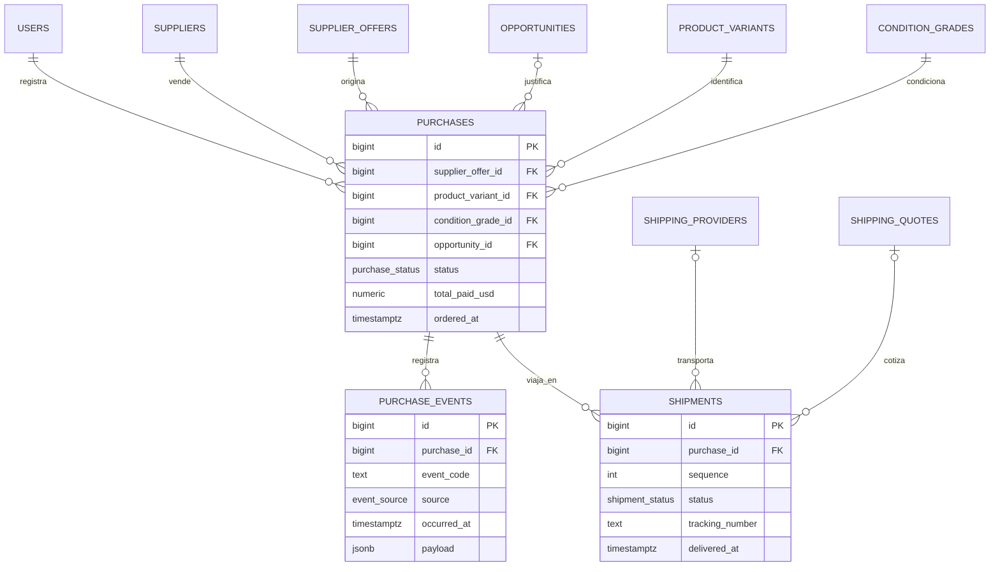

# Diseño de compras — Fase A

**Estado:** propuesto, pendiente de aprobación
**Alcance:** Fase A (compras) únicamente. La parte fiscal se documenta sólo como frontera.
**Fecha:** 2026-10-16
**Base:** [overview.md](./overview.md), [data-model-phase-1.md](./data-model-phase-1.md), [implementation-plan.md](./implementation-plan.md), [ADR-0003](../adr/0003-prisma-7-postgresql.md), [ADR-0004](../adr/0004-gated-database-migrations.md)

> Este documento **no** crea `prisma/schema.prisma`, **no** genera SQL y **no** aplica
> migraciones. > Actualizado el 2026-10-16 para alinearse con el catálogo multiproducto de
> [ADR-0005](../adr/0005-multi-product-catalog.md), la
> [lista de verificación del esquema](./multi-product-prisma-schema-checklist.md) y el
> [contraste con el dominio](./purchases-phase-a-schema-review.md).

A la fecha el repositorio no tiene directorio `prisma/`, ni `supabase/`,
> ni configuración de Supabase; el modelo de datos sigue siendo una propuesta no
> aplicada. Cualquier cambio estructural posterior sigue el gate de
> [ADR-0004](../adr/0004-gated-database-migrations.md): documento → aprobación →
> `schema.prisma` → migración en modo `create-only` → revisión del SQL → aplicación
> en desarrollo.

---

## 1. Entidades actuales relacionadas y qué se reutiliza

No existe ninguna tabla creada. Las "entidades actuales" son las **propuestas** de
[data-model-phase-1.md](./data-model-phase-1.md), que Fase A extiende de forma aditiva.

### 1.1 Se reutiliza tal cual

| Entidad propuesta | Uso en Fase A | Nota |
| --- | --- | --- |
| `users` | `created_by_user_id` de compras y eventos | Identidad local del operador. Fase A es un único `ADMIN`; la columna permite multiusuario futuro sin migración |
| `suppliers` | `supplier_id` de la compra | `connector_key` + `integration_mode` ya prevén el origen manual/API de un marketplace como proveedor de compra |
| `supplier_offers` | `supplier_offer_id` de la compra | Es la oferta observada que originó la compra; ya tiene precio, envío USA, impuesto, comisión y calidad |
| `products` / `product_variants` | `product_variant_id` | SKU normalizado; el texto de la publicación nunca lo sustituye |
| `product_categories` | ninguna columna | La compra **no** referencia la categoría: se deduce desde la variante. Consecuencia directa de ADR-0005 |
| `brands` | ninguna columna | La marca tampoco se duplica en la compra |
| `attribute_definitions` | ninguna columna | Los atributos de configuración (capacidad, edición) viven en la variante, no en la compra |
| `product_variant_attribute_values` | ninguna columna | Se consultan por variante cuando se necesita el detalle del SKU |
| `condition_grades` | `condition_grade_id` | La condición se congela en la compra: es un hecho histórico. La escala pertenece a la categoría, de modo que la compra sigue siendo interpretable sin conocer el producto |
| `shipping_providers` | `shipping_provider_id` del envío | Catálogo existente, sin cambios |
| `shipping_quotes` | `shipping_quote_id` del envío | Cotización que originó el envío; la cotización y el envío son cosas distintas |
| `opportunities` | `opportunity_id` de la compra | `opportunities.status` ya contempla `PURCHASED`; la relación se crea desde `purchases`, no alterando `opportunities` |

### 1.2 Decisión de encaje con el módulo `markets`

El módulo `markets` (ya implementado en código) produce ofertas normalizadas de
**marketsplaces de compra en EE. UU.** (eBay, Best Buy, Walmart, entrada manual).
El adaptador `markets → opportunities` ya produce `supplierId`, `productVariantId`,
condición e importes en USD, que es exactamente la forma de `suppliers` +
`supplier_offers` + `product_variants`.

Conclusión: **una oferta de compra de mercado se persiste como `supplier_offers` cuyo
`supplier` es el marketplace**, y `market_listings` sigue reservado para los
comparables de venta en Colombia. No se crea una tercera vía de ofertas ni una tabla
de ofertas de mercado. Confirmar en el gate: el documento de Fase 1 llama "marketplaces"
a los comparables Colombia, y esta es la lectura que evita duplicar el mismo dato.

### 1.3 Compatibilidad con el catálogo multiproducto

La compra referencia **únicamente** `product_variant_id`. No tiene columnas de
marca, categoría, modelo ni atributos de variante, y esa es la razón por la que el
mismo esquema sirve para un iPhone y para una consola:

| Necesidad | Cómo se resuelve sin columnas en la compra |
| --- | --- |
| Saber la categoría | Catálogo: variante → producto → marca, y la categoría del producto |
| Conocer capacidad o edición | Catálogo: atributos tipados de la variante |
| Congelar la condición comprada | `condition_grade_id` en la compra, que es un hecho histórico |
| No duplicar datos que cambian | El catálogo se desactiva; la compra no se altera |

**PS5 como segundo caso.** Una consola no cambia ni una tabla ni una fórmula: cambia
el catálogo que la alimenta. Si una compra de consola se puede mostrar y auditar con
las mismas secciones, el diseño es correcto; si exigiera columnas nuevas, el diseño
estaría roto.

### 1.4 No se reutiliza (frontera explícita)

| Entidad diferida | Por qué no entra en Fase A |
| --- | --- |
| `InventoryItem` (+ protección de IMEI) | Fase A registra **la compra**, no el inventario recibido. El IMEI es el dato más sensible del modelo y exige cifrado, enmascarado y autorización explícita antes de existir |
| `Sale`, `Expense`, `CapitalTransaction` | Libro de capital y resultado: Fase B/C |
| `Watchlist`, `PriceSnapshot` | Radar y precio objetivo: frente paralelo |
| `Alert` | Notificaciones: Fase posterior |

Fase A **tampoco** modela fiscalidad. `sales_tax_usd` de una compra es el impuesto
que el **mercado cobró en EE. UU.** y forma parte del costo; no es un registro
fiscal ni una obligación tributaria. Ver §10.

---

## 2. Entidades nuevas necesarias para Fase A

Tres tablas, todas nuevas. Ninguna altera una tabla existente.

### 2.1 `purchases`

Hecho de negocio: "compré esta unidad a este proveedor". Es el ancla de la Fase A.

| Columna | Tipo | Regla |
| --- | --- | --- |
| `id` | `bigint generated always as identity` | PK |
| `created_by_user_id` | `bigint` → `users(id)` | NOT NULL, `ON DELETE RESTRICT` |
| `reference_code` | `text` | Código corto legible por el operador. NOT NULL, único por usuario |
| `status` | `purchase_status` | NOT NULL, default `DRAFT` |
| `supplier_id` | `bigint` → `suppliers(id)` | NOT NULL, `ON DELETE RESTRICT` |
| `supplier_offer_id` | `bigint` → `supplier_offers(id)` | NOT NULL, `ON DELETE RESTRICT` |
| `opportunity_id` | `bigint` → `opportunities(id)` | NULL, `ON DELETE RESTRICT`; la compra puede hacerse sin oportunidad previa |
| `product_variant_id` | `bigint` → `product_variants(id)` | NOT NULL, `ON DELETE RESTRICT` |
| `condition_grade_id` | `bigint` → `condition_grades(id)` | NOT NULL, `ON DELETE RESTRICT`; grado congelado en el momento de la compra |
| `currency_code` | `char(3)` | NOT NULL, mayúsculas. Fase A sólo `USD` |
| `purchase_price_usd` | `numeric(20,4)` | NULL sólo en `DRAFT` |
| `us_shipping_usd` | `numeric(20,4)` | NULL sólo en `DRAFT` |
| `us_sales_tax_usd` | `numeric(20,4)` | NULL sólo en `DRAFT` |
| `payment_fee_usd` | `numeric(20,4)` | NULL sólo en `DRAFT` |
| `other_cost_usd` | `numeric(20,4)` | NULL sólo en `DRAFT`. Ausente ≠ 0 |
| `paid_amount_usd` | `numeric(20,4)` | Importe efectivamente pagado. NULL hasta registrar el pago. Decisión P1 |
| `total_paid_usd` | `numeric(20,4)` | Suma exacta de los cinco componentes. NULL sólo en `DRAFT` |
| `ordered_at` | `timestamptz` | Instante del pedido en el proveedor (UTC) |
| `paid_at` | `timestamptz` | NULL hasta registrar el pago |
| `estimated_delivery_at` | `timestamptz` | NULL si el proveedor no lo informa |
| `delivered_at` | `timestamptz` | NULL hasta la entrega |
| `cancelled_at` | `timestamptz` | NULL salvo cancelación |
| `cancellation_reason` | `text` | NULL salvo cancelación |
| `source_url` | `text` | Enlace al aviso original; NULL si no se guardó |
| `revision` | `int` | NOT NULL, default 1. Incrementa en cada corrección registrada |
| `notes` | `text` | Notas del operador. Sin datos de tarjeta ni de cuenta del proveedor |
| `created_at`, `updated_at` | `timestamptz` | NOT NULL |

Columnas deliberadamente **ausentes** en Fase A: categoría, marca, modelo y atributos
de variante, que viven en el catálogo; todo importe en COP, costo puesto en
Colombia, impuesto de importación, utilidad, ROI, y cualquier campo fiscal o de
inventario. No existen todavía fuentes de verdad para ellos.

### 2.2 `purchase_events`

Bitácora append-only del ciclo de vida. Es la fuente de verdad de "qué pasó y cuándo",
y hace auditable cada transición sin reescribir historia.

| Columna | Tipo | Regla |
| --- | --- | --- |
| `id` | `bigint generated always as identity` | PK |
| `purchase_id` | `bigint` → `purchases(id)` | NOT NULL, `ON DELETE RESTRICT` |
| `event_code` | `text` | NOT NULL. Código del evento, no enum cerrado (§8) |
| `source` | `event_source` | NOT NULL: `USER`, `SYSTEM`, `IMPORT` |
| `occurred_at` | `timestamptz` | NOT NULL. Instante en que ocurrió el hecho |
| `recorded_at` | `timestamptz` | NOT NULL, default ahora() |
| `created_by_user_id` | `bigint` → `users(id)` | NULL para eventos automáticos |
| `payload` | `jsonb` | NOT NULL, objeto con esquema versionado y validado con Zod. Sin secretos |
| `notes` | `text` | Contexto legible |

**No tiene `updated_at`**: la fila no se modifica. No se concede UPDATE ni DELETE; la
corrección se registra como un evento nuevo que referencia al anterior.

### 2.3 `shipments`

Un envío físico por compra. Permite más de uno (separación, parcialidad, reenvío) sin
modelar logística avanzada.

| Columna | Tipo | Regla |
| --- | --- | --- |
| `id` | `bigint generated always as identity` | PK |
| `purchase_id` | `bigint` → `purchases(id)` | NOT NULL, `ON DELETE RESTRICT` |
| `sequence` | `int` | NOT NULL, > 0. Único junto a `purchase_id` |
| `status` | `shipment_status` | NOT NULL, default `PENDING` |
| `shipping_provider_id` | `bigint` → `shipping_providers(id)` | NULL, `ON DELETE RESTRICT` |
| `shipping_quote_id` | `bigint` → `shipping_quotes(id)` | NULL, `ON DELETE RESTRICT` |
| `carrier_name` | `text` | Transportista reportada. NULL si no se informó |
| `tracking_number` | `text` | NULL. Dato sensible: ver §9 |
| `tracking_url` | `text` | NULL |
| `dispatched_at` | `timestamptz` | NULL |
| `estimated_delivery_at` | `timestamptz` | NULL |
| `delivered_at` | `timestamptz` | NULL |
| `actual_cost_usd` | `numeric(20,4)` | NULL. Desconocido ≠ 0 |
| `actual_weight_lb` | `numeric(10,3)` | Peso **del paquete**, medido. NULL si no se midió; nunca 0 ni copiado de la ficha técnica |
| `weight_source` | `text` | Cómo se obtuvo el peso: `MEASURED` o `DECLARED`. Permite auditar el costo |
| `volumetric_divisor` | `numeric(18,8)` | Divisor aplicado cuando el peso volumétrico preguió al real. NULL si no aplica |
| `notes` | `text` | NOTAS del operador |
| `created_at`, `updated_at` | `timestamptz` | NOT NULL |

**No se almacenan** dirección de destino, nombre del receptor, teléfono, correo ni
documento de identidad. Fase A no tiene receptor identificado como cliente: el
envío va a una dirección de casillero ya existente fuera de ReventaIQ.

**Peso de producto frente a peso de paquete.** El peso y las dimensiones de
producto viven en `product_variants` (ficha técnica) y sirven para dimensionar caja y
comparar fichas. El peso del paquete se mide en `shipments` y es el único que puede
facturar. Nunca se deriva uno del otro: caja, protección y accesorios incluidos
cambian el peso, y un paquete de peso desconocido es `NULL`, no cero.

**Moneda del costo real del envío.** `actual_cost_usd` registra el costo observado en
la divisa en que se pagó, sin convertirlo. La conversión a COP y el peso volumétrico
pertenecen al módulo financiero, que aplica la tasa vigente en el momento; Fase A no
almacena importes convertidos. Esta decisión resuelve el conflicto detectado en §9 de
este documento y en la revisión de esquema (decisión P3).

### 2.4 Relaciones nuevas (ERD)



---

## 3. Relaciones, cardinalidades, ownership y reglas de borrado

### 3.1 Cardinalidades

| Relación | Cardinalidad | Nota |
| --- | --- | --- |
| `purchases` → `supplier_offers` | N:1, obligatoria | Una oferta puede terminar en **como máximo una** compra activa; se evita el doble registro de la misma unidad (índice único parcial en §9) |
| `purchases` → `opportunities` | N:1 opcional | Varias compras pueden justificarse por el mismo análisis (misma oportunidad, varias unidades) |
| `purchases` → `purchase_events` | 1:N | Una compra sin eventos es un error de proceso, no un estado válido |
| `purchases` → `shipments` | 1:N | 0..N: la compra existe antes de que exista el envío |
| `shipments` → `shipping_quotes` | N:1 opcional | Reutiliza cotizaciones; nunca se duplica una cotización por un envío |
| `purchase_events` → `users` | N:1 opcional | NULL en eventos automáticos del sistema |

### 3.2 Ownership

- El dueño de una compra es `purchases.created_by_user_id`. Los envíos y los eventos
  **no repiten** la columna de propietario: se heredan de la compra. Duplicarla
  obligaría a mantenerla coherente y a indexarla dos veces.
- En Fase A el único rol es `ADMIN` y hay un solo usuario. La columna existe desde el
  día uno para que el multiusuario futuro no requiera una migración de datos.
- Una compra **no** tiene proveedor propietario: el proveedor es un dato de referencia
  de un catálogo, no una parte que controle el registro.

### 3.3 Reglas de borrado

**Ninguna tabla nueva usa `ON DELETE CASCADE`.** Todas las FK son `RESTRICT`
(equivalente a `NO ACTION`) y los catálogos referenciados se desactivan
(`is_active`), no se eliminan.

Justificación:

1. El modelo de datos establece que "los registros usados por una oportunidad no se
   eliminan físicamente" y que los catálogos se desactivan para no destruir
   trazabilidad. Fase A es la tabla que más evidencia contiene.
2. Una compra es evidencia de una decisión de inversión: borrarla, o borrarla en
   cascada, destruiría la bitácora que explica por qué se compró.
3. `purchase_events` es append-only: si se permitiera el borrado en cascada,
   "auditable" sería una afirmación sin respaldo.
4. Las rutas de borrado se documentan como "cancelar" (cambio de estado con
   motivo) y nunca "eliminar". La UI no expone acciones destructivas de borrado.

Excepción thoughtfully considerada y **descartada**: `purchase_events.purchase_id` con
`CASCADE` sería cómodo en pruebas, pero deja huecos silenciosos en la auditoría. Se
descarta también `SET NULL` para `opportunity_id`: perdería el vínculo con el análisis
que justificó la compra sin aportar nada.

---

## 4. Propuesta de cambios no destructivos al esquema

**No se crea `schema.prisma`, ni SQL, ni migración.** Lo que sigue es el modelo
propuesto para el gate de ADR-0004.

### 4.1 Carácter del cambio

- **100 % aditivo**: tres tablas nuevas.
- **Cero `ALTER TABLE`** sobre tablas existentes. En particular, **no** se añade
  `purchase_id` a `opportunities`: la relación vive en `purchases.opportunity_id`.
- **Cero cambios en datos** existentes: no hay backfill, no hay `UPDATE`.
- Reversión conceptual: eliminar las tres tablas. Como no hay FK desde tablas
  existentes hacia ellas, la reversión no toca nada preexistente.

### 4.2 Nombres físicos

Convenciones heredadas de Fase 1 y verificadas con las guías de PostgreSQL:

| Elemento | Convención | Fundamento |
| --- | --- | --- |
| Tablas, columnas, índices, constraints | `snake_case` minúsculas | Fase 1 + convención PostgreSQL |
| Clave primaria | `bigint generated always as identity` | Secuencial, 8 bytes, estándar SQL; evita la fragmentación de índices que producen los UUID aleatorios |
| Identificadores en JSON y DTO | string decimal | Coherente con Fase 1; JS no puede representar `bigint` de forma segura |
| Texto | `text`, sin `varchar(n)` arbitrario | Sin límite de negocio real |
| Instantes | `timestamptz`, UTC | Se conserva UTC; `America/Bogota` sólo para presentación |
| Dinero | `numeric(20,4)` | Precisión exacta; nunca `float`/`double precision` |
| Tasas y porcentajes | `numeric(18,8)` | Fracciones, no porcentajes visuales |
| Códigos monetarios | `char(3)` ISO 4217 | Sin enum cerrado |
| Booleanos | `boolean` | Nunca `varchar` |
| Estados | enums de PostgreSQL frente a `text` + `CHECK` | Decisión diferida al gate de revisión de esquema, igual que Fase 1 |

### 4.3 Tipos enumerados propuestos

Sólo estados de ciclo de vida estables, alineados con el criterio de Fase 1
("sólo los estados de ciclo de vida estables se consideran enums"):

```text
purchase_status: DRAFT, CONFIRMED, PAID, IN_TRANSIT, DELIVERED, CANCELLED
shipment_status: PENDING, DISPATCHED, IN_CUSTOMS, OUT_FOR_DELIVERY, DELIVERED, EXCEPTION, CANCELLED
event_source:    USER, SYSTEM, IMPORT
```

`event_code` **no** es enum: es un catálogo de eventos que crecerá por fases (Fase B
añade receiptos, devoluciones, ventas). Vive como `text` validado por Zod en el
dominio, no por la base de datos.

### 4.4 Índices, constraints y unicidad propuestos

Íntegramente listados en §9 para mantener el razonamiento junto al riesgo.

---

---

## 4bis. Decisiones adoptadas en esta actualización

| # | Decisión | Qué se adopta |
| --- | --- | --- |
| **P1** | Importe pagado | `purchases.paid_amount_usd numeric(20,4)`, con constraint de igualdad contra `total_paid_usd` en el estado `PAID`. El código de aplicación ya exige el dato; sin columna la acción de pago no tenía dónde escribir |
| **P3** | Costo real del envío | Se registra en la divisa observada (`actual_cost_usd`), sin conversión almacenada. La conversión a COP y el peso volumétrico se calculan en `finance`, que aplica la tasa vigente. Se añaden `weight_source` y `volumetric_divisor` para poder auditar el total |
| **DB** | Producto frente a paquete | El peso de producto vive en la variante; el de paquete, medido, en el envío. Prohibido rellenar uno con el otro |
| **ADR-0005** | Multiproducto | La compra referencia sólo `product_variant_id`; sin columnas de categoría, marca ni atributos |

Ninguna de estas decisiones cambia el motor financiero ni el Opportunity Engine.

---

## 5. Rutas `/purchases` y `/purchases/[id]`

Siguen el flujo de solicitud de [overview.md](./overview.md) §"Flujo de una solicitud":
Server Component → caso de uso → puerto; Server Action para mutaciones; sin API
intermedia innecesaria entre Server Components y casos de uso.

### 5.1 `/purchases`

| Aspecto | Decisión |
| --- | --- |
| Tipo | Server Component de lectura. Sin estado de cliente para los datos |
| Caso de uso | `listPurchases(query, cursor)` — devuelve DTO, nunca modelos Prisma |
| Origen | `purchaseRepository.list()` con filtros por `status`, proveedor, variante, condición y rango de fechas |
| Paginación | **Por cursor (keyset)**, no `OFFSET`: el cursor incluye todas las columnas del orden más `id` como desempate. Profundidad constante O(1) |
| Orden por defecto | `created_at DESC, id DESC`, consistente con el resto del producto |
| Formato | `numeric` y `bigint` se serializan explícitamente a string antes de cruzar al Client Component (Fase 1, principio 5) |
| Acciones | `createPurchase`, `confirmPurchase`, `recordPayment`, `cancelPurchase` como Server Actions con validación Zod |
| Autorización | Verificación de administrador en **cada** mutación, desde Etapa 7 del plan |
| Estados de UI | Cargando, vacío inicial (una sola acción siguiente), sin resultados (conserva filtros), incompleto, desactualizado, error |
| Responsive | ≥1280 tabla completa; 1024–1279 columnas secundarias ocultables; 768–1023 sólo columnas críticas; <768 tarjetas de decisión |
| Navegación | Nueva entrada "Compras" en la sidebar, con `aria-current="page"`; hoy `page.tsx` navega por anclas `#`, por lo que la ruta real exige actualizar esa lista cuando exista el route group `(app)` |

Ningún Route Handler: no hay frontera HTTP real en esta fase.

### 5.2 `/purchases/[id]`

| Aspecto | Decisión |
| --- | --- |
| Tipo | Server Component de lectura, con Server Actions para las transiciones de estado |
| Carga | Compra + proveedor + variante + condición + oportunidad vinculada + envíos + eventos en la misma transacción de lectura |
| Secciones | 1) Franja de decisión: estado, fecha de pedido, completitud y próxima acción · 2) Identidad normalizada y enlace a la fuente · 3) Desglose monetario por componentes con moneda explícita · 4) Envíos · 5) Línea de tiempo de eventos · 6) Auditoría: versión de configuración y análisis que la justifica |
| Desglose | Componentes con sangría, regla superior para subtotal, fórmula consultable y disclosure progresivo (MASTER §7.3) |
| Valores desconocidos | `Sin dato`, nunca `0`. Nunca completar con una suposición favorable |
| Valores no calculados | `No calculable` / `Aún no calculada`, en tinta atenuada, como estado neutral y no como rechazo |
| Acciones | Sólo transiciones válidas desde el estado actual (§8). Sin acciones falsas |
| Cancelación | Diálogo de confirmación proporcional con motivo obligatorio; coral por ser destructiva en el sentido de negocio |
| Estados | Mismos estados transversales que el detalle de oportunidad (ux-phase-1 §7) |
| Currency/moneda | `USD` explícito en campo, celda, subtotal y valor accesible; cifras tabulares |

### 5.3 Lo que estas rutas NO hacen

- No convierten a COP, no calculan costo puesto en Colombia, no calculan utilidad ni ROI.
- No inventan un precio conservador ni muestran comparables: eso es `opportunities`.
- No registran inventario, IMEI, gastos ni ventas.

---

## 6. Componentes UI necesarios

Todos consumen tokens semánticos del sistema de diseño; ninguno incorpora hexadecimales
propios. Lista de componentes nuevos o reutilizables:

| Componente | Ubicación sugerida | Responsabilidad | Reglas de diseño |
| --- | --- | --- | --- |
| `PurchaseTable` | `src/components/ui/` | Listado con orden por botón (nombre y dirección anunciados), filtros y cursor | Filas 52–60 px; en móvil se convierte en tarjetas; acciones de fila separadas del enlace principal |
| `PurchaseRow` / `PurchaseCard` | `src/components/ui/` | Fila de escritorio y tarjeta móvil con la misma información | Prioridad por decisión, no por tamaño; nunca ocho columnas estrechas |
| `PurchaseStatusBadge` | `src/components/ui/` | Estado con icono + etiqueta completa | `No calculable` y `Borrador` son neutros, no rechazos; color siempre acompañado de texto e icono |
| `PurchaseDecisionStrip` | `src/components/purchases/` | Franja de decisión: estado, fecha, completitud y próxima acción | Borde izquierdo semántico de 4 px, superficie blanca; el fondo no se tiñe completo (MASTER §7.1) |
| `PurchaseMoneyBreakdown` | `src/components/purchases/` | Componentes, subtotal y moneda | Concepto a la izquierda, importe y moneda a la derecha; `Sin dato` para ausentes; nunca recalcula |
| `ShipmentList` / `ShipmentCard` | `src/components/purchases/` | Envíos de la compra | Número de seguimiento enmascarado por defecto; reveal explícito |
| `PurchaseTimeline` | `src/components/purchases/` | Eventos en orden cronológico | `occurred_at` en UTC con zona visible; differentiate `USER` de `SYSTEM` con texto, no sólo color |
| `MoneyCell` (reutilizable) | `src/components/ui/` | Importe tabular con moneda | `Geist Mono`, `tabular-nums`, alineado a la derecha; el valor completo está en texto accesible, nunca sólo en tooltip |
| `EmptyState` / `IncompleteState` | `src/components/ui/` | Vacío inicial, sin resultados y datos faltantes | Vacío inicial: explica qué falta y ofrece **una** acción siguiente |
| `FilterBar` | `src/components/ui/` | Filtros por estado, proveedor, variante y fecha | Sin resultados conserva filtros y permite limpiarlos |
| `CursorPagination` | `src/components/ui/` | Navegación por cursor | `Anterior`/`Siguiente`; el estado vacío nooffers cursor inválido |
| `TransitionDialog` | `src/components/ui/` | Confirmación de transición sensible | Motivo obligatorio; foco atrapado; error enlazado con `aria-describedby` |
| `Field` / `FormField` (reutilizable) | `src/components/ui/` | Campos de captura | 44 px mínimo; etiqueta sobre el control; prefijo de moneda visible; validación al salir del campo |
| `SourceLink` (reutilizable) | `src/components/ui/` | Enlace a la publicación original | Sólo si existe `source_url`; enlace externo con advertencia de que ReventaIQ no vende ni reserva |

Ningún componente inventa contenido para verse lleno. No hay datos, tasas ni
tendencias sintéticas.

---

## 7. Funciones de dominio necesarias

Puras, en `src/modules/purchases/domain/`, sin React, Next.js, Prisma ni SDKs
externos. Sin costos reales ni lógica fiscal. El reloj se inyecta siempre
(`evaluatedAt`), como en `finance/time.ts`.

### 7.1 Puertos de agregación

| Función | Firma conceptual | Regla |
| --- | --- | --- |
| `calculatePurchaseTotalUSD(components)` | `(components) => Decimal` | Suma **exacta** de precio, envío, impuesto, comisión y otros costos. Un componente ausente hace fallar la función; no se trata como 0 |
| `assertPurchaseComponents(input)` | `(input) => void` | Rechaza negativos, no finitos y moneda distinta de la esperada |
| `summarizePurchaseMoney(purchase)` | `(purchase) => PurchaseMoneySummary` | Total, componentes y lista de componentes ausentes, para que la UI muestre `Sin dato` |

### 7.2 Máquina de estados

| Función | Regla |
| --- | --- |
| `assertPurchaseTransition(from, to)` | Lanza error de dominio si la transición no está permitida (§8) |
| `nextPurchaseStatus(current, action)` | Función pura: estado + acción → estado siguiente o error |
| `availablePurchaseActions(status)` | Alimenta la UI: sólo acciones válidas, para no ofrecer botones falsos |
| `canEditPurchaseAmounts(status)` | Sólo antes del pago; después la corrección es un evento, no una edición silenciosa |
| `isPurchaseTerminal(status)` | `DELIVERED` y `CANCELLED` no admiten más transiciones |

### 7.3 Eventos y línea de tiempo

| Función | Regla |
| --- | --- |
| `buildPurchaseTimeline(events)` | Orden determinista por `occurred_at` y luego `id`; sin leer el reloj |
| `deriveAutomaticEvents(state, evaluatedAt)` | Eventos que el sistema debe registrar por cambio de estado (§8) |
| `validatePurchaseEventPayload(payload)` | Esquema Zod versionado antes de persistir y al leer |

### 7.4 Completitud y vencimiento

| Función | Regla |
| --- | --- |
| `purchaseCompletionGaps(purchase)` | Lista de faltantes: componentes de dinero, condición, proveedor, envío. Ausente ≠ cero |
| `isPurchaseOverdue(purchase, evaluatedAt)` | Compara `estimated_delivery_at` con un instante **inyectado** |
| `nextPurchaseAction(purchase)` | Acción siguiente sugerida, para el estado vacío y la franja de decisión |

### 7.5 Validación de entrada

| Función | Regla |
| --- | --- |
| `validatePurchaseRegistration(input)` | Zod en el borde del servidor; devuelve errores por campo |
| `validateShipmentRegistration(input)` | Ídem para envíos, incluyendo formato de seguimiento y unicidad por compra |

**Fuera de alcance en Fase A:** conversión de moneda, costo de cambio, costo puesto en
Colombia, importación, nacionalización, reservas, utilidad, ROI y cualquier cálculo
fiscal. Esas fórmulas viven en `finance` y `opportunities` y no se duplican aquí.

---

## 8. Estados, transiciones válidas y eventos automáticos

### 8.1 Estados de compra

| Estado | Significado | Datos exigidos |
| --- | --- | --- |
| `DRAFT` | Borrador; puede tener campos nulos | Ninguno |
| `CONFIRMED` | Pedido confirmado con el proveedor | Todos los componentes de dinero, `condition_grade_id` |
| `PAID` | Pago ejecutado | `paid_at` |
| `IN_TRANSIT` | Al menos un envío en tránsito | Al menos un envío |
| `DELIVERED` | Recibida en destino | `delivered_at`; todos los envíos `DELIVERED` |
| `CANCELLED` | Compra cancelada | `cancelled_at` y `cancellation_reason` |

### 8.2 Transiciones permitidas

| De | A | Disparador | Evento resultante |
| --- | --- | --- | --- |
| `DRAFT` | `CONFIRMED` | Usuario | `PURCHASE_CONFIRMED` |
| `DRAFT` | `CANCELLED` | Usuario | `PURCHASE_CANCELLED` |
| `CONFIRMED` | `PAID` | Usuario | `PAYMENT_RECORDED` |
| `CONFIRMED` | `CANCELLED` | Usuario | `PURCHASE_CANCELLED` |
| `PAID` | `IN_TRANSIT` | Sistema (primer envío en tránsito) | `SHIPMENT_DISPATCHED` |
| `PAID` | `CANCELLED` | Usuario, con motivo | `PURCHASE_CANCELLED` |
| `IN_TRANSIT` | `DELIVERED` | Sistema (todos los envíos entregados) | `PURCHASE_DELIVERED` |
| `CANCELLED` | `DRAFT` | Usuario, sólo si no hubo pago | `PURCHASE_REOPENED` |
| `DELIVERED` | — | — | Terminal |
| `CANCELLED` con `paid_at` | `DRAFT` | — | **Prohibida** |

Cualquier otra transición lanza error de dominio. La UI no la ofrece y el caso de uso
la rechaza aunque se invoque directamente: la validación vive en el dominio, no en el
formulario.

### 8.3 Eventos de la bitácora

| `event_code` | Origen | Contenido mínimo del `payload` |
| --- | --- | --- |
| `PURCHASE_CREATED` | `USER` | Estado inicial, componentes si fueron capturados |
| `PURCHASE_CONFIRMED` | `USER` | Componentes confirmados y su suma |
| `PAYMENT_RECORDED` | `USER` | `paid_at`, importe pagado |
| `SHIPMENT_DISPATCHED` | `SYSTEM` | Envío, transportista, tracking si existe |
| `SHIPMENT_STATUS_CHANGED` | `USER`/`SYSTEM` | Envío, estado anterior y nuevo |
| `SHIPMENT_EXCEEDED_ESTIMATE` | `SYSTEM` | Estimado vs. real, si ambos existen |
| `PURCHASE_DELIVERED` | `SYSTEM` | `delivered_at`,y número de envíos |
| `PURCHASE_CANCELLED` | `USER` | Motivo |
| `PURCHASE_REOPENED` | `USER` | Motivo |
| `DATA_CORRECTED` | `USER` | Campo, valor anterior y nuevo. **Obligatorio** antes de `PAID` |
| `NOTE_ADDED` | `USER` | Nota |

Reglas de los eventos automáticos:

1. Se derivan del cambio de estado, no de la entrada del usuario, y se escriben en la
   **misma transacción** que el cambio de estado. Si el evento falla, la transición
   falla.
2. Son idempotentes por construcción: se vuelven a calcular desde el estado, no se
   guardan como banderas.
3. Los eventos del sistema no tienen `created_by_user_id`; la UI los distingue por
   `source`, con texto, no sólo con color.
4. `DATA_CORRECTED` incrementa `purchases.revision`. Nada se edita en silencio: cada
   corrección deja el valor anterior en el evento.

---

## 9. Índices, constraints, auditoría y riesgos

### 9.1 Índices

PostgreSQL **no** indexa las FK automáticamente: cada FK nueva lleva su índice, salvo
que ya sea el prefijo izquierdo de un índice compuesto equivalente. En los índices
compuestos, primero las columnas de igualdad, después los rangos y el orden, y
finalmente `id` como desempaste estable para la paginación por cursor.

**Lectura principal de `/purchases`:**

| Índice | Tipo | Consulta que sirve |
| --- | --- | --- |
| `purchases (status, created_at DESC, id DESC)` | compuesto | Filtro por estado + orden por fecha |
| `purchases (created_at DESC, id DESC)` | compuesto | Listado sin filtro de estado + cursor |
| `purchases (status, supplier_id, created_at DESC, id DESC)` | compuesto | Filtro por estado y proveedor |
| `purchases (supplier_offer_id, created_at DESC, id DESC)` | compuesto | FK `supplier_offer_id` + historial de esa oferta |

**Índices de FK (obligatorios):**

| Índice | Cubre |
| --- | --- |
| `purchases (created_by_user_id)` | FK a `users` |
| `purchases (supplier_id)` | FK a `suppliers` |
| `purchases (product_variant_id)` | FK a `product_variants` |
| `purchases (condition_grade_id)` | FK a `condition_grades` |
| `purchases (opportunity_id) WHERE opportunity_id IS NOT NULL` | FK a `opportunities`, parcial y más pequeño |
| `purchase_events (purchase_id, occurred_at DESC, id DESC)` | FK a `purchases` + línea de tiempo |
| `shipments (purchase_id, sequence)` | FK a `purchases` + unicidad de secuencia |

**Índices parciales y de unicidad:**

| Índice | Tipo | Propósito |
| --- | --- | --- |
| `purchases (created_by_user_id, reference_code)` | único | Código legible único por operador |
| `purchases (supplier_offer_id) WHERE status <> 'CANCELLED'` | único parcial | Una sola compra viva por oferta: evita registrar dos veces la misma unidad |
| `shipments (carrier_name, tracking_number) WHERE tracking_number IS NOT NULL` | único parcial | Detecta seguimiento duplicado sin exigir el valor |
| `purchases (status, estimated_delivery_at) WHERE status IN ('CONFIRMED','PAID','IN_TRANSIT')` | parcial | Cola de compras vivas para revisar vencimientos |
| `purchase_events (event_code, occurred_at DESC) WHERE source = 'SYSTEM'` | parcial | Auditoría de eventos automáticos |

**No se crea ningún índice GIN sobre `payload`.** Un `jsonb` sin consulta que lo
justifique sólo añade costo de escritura; se añadirá GIN o un índice por expresión
cuando exista una consulta y un plan de ejecución que lo pidan.

### 9.2 Constraints

| Constraint | Tipo | Regla |
| --- | --- | --- |
| PK `id` | PK | `bigint identity` |
| `reference_code` no vacío | `CHECK` | `length(btrim(reference_code)) > 0` |
| Estados dentro del dominio | `CHECK` o enum | Según la decisión del gate de esquema |
| Importes no negativos | `CHECK` | Todos los `*_usd >= 0` y `actual_weight_lb > 0` |
| `currency_code` | `CHECK` | Tres letras mayúsculas |
| Integridad de importes por estado | `CHECK` | `status = 'DRAFT'` **o** los cinco componentes y `total_paid_usd` NOT NULL |
| `total_paid_usd` = suma de componentes | `CHECK` | `total_paid_usd = purchase_price_usd + us_shipping_usd + us_sales_tax_usd + payment_fee_usd + other_cost_usd` |
| Orden de instantes | `CHECK` | `paid_at >= ordered_at`; `delivered_at >= ordered_at`; `cancelled_at >= ordered_at`; `delivered_at >= dispatched_at` en envíos |
| `sequence > 0` | `CHECK` | Numeración de envíos |
| Un envío por secuencia | `UNIQUE` | `(purchase_id, sequence)` |
| Terminación coherente | `CHECK` | `status = 'DELIVERED'` exige `delivered_at NOT NULL`; `status = 'CANCELLED'` exige `cancelled_at` y motivo |
| FK | `RESTRICT` | Ninguna cascada (§3.3) |

Sobre idempotencia de constraints: PostgreSQL **no** soporta
`ADD CONSTRAINT IF NOT EXISTS`. Si alguna de estas restricciones se añade en SQL de una
migración `create-only`, debe comprobarse antes con `pg_constraint` (patrón `DO $$`),
nunca con esa sintaxis.

### 9.3 Auditoría

| Mecanismo | Alcance |
| --- | --- |
| `purchase_events` append-only | Quién hizo qué y cuándo, con payload versionado |
| `purchases.revision` | Número de corrección aplicada; permite ver que hubo cambios |
| `purchases.opportunity_id` | Vínculo al análisis que justificó la compra, con su propia configuración versionada |
| `source_url` + instantes | Procedencia y momento de la observación (principio 5 de Fase 1) |
| `condition_grade_id` congelado | La condición es un hecho histórico, no una referencia viva |
| Ausencia de borrado físico | Cancelar con motivo; nunca eliminar |

La auditoría responde siempre a tres preguntas: **qué** pasó, **quién o qué** lo causó,
**con qué datos**. Un evento sin `occurred_at` o sin `source` no es un evento válido.

### 9.4 Supabase: no asumido, y qué haría falta si se adopta

**Hoy no hay Supabase.** El ADR-0003 fija Prisma 7 sobre PostgreSQL, con una conexión
de aplicación sin privilegios de propietario del esquema; no existe directorio
`supabase/`, ni `config.toml`, ni cliente `@supabase/supabase-js`. Este documento **no
asume** Supabase configurada ni diseña sobre `auth.uid()`.

Si más adelante se adopta Supabase, para estas tres tablas habría que:

1. Habilitar RLS en cada tabla y usar `FORCE ROW LEVEL SECURITY` para que el
   propietario del esquema tampoco quede por encima de las políticas.
2. Escribir políticas con el rol destino explícito (`TO authenticated`), nunca con
   `auth.role()` (deprecado) y nunca sólo `TO authenticated`, que es autenticación sin
   autorización.
3. Envolver la función de contexto: `using ((select auth.uid()) = created_by_user_id)`,
   para que se evalúe una vez y no por fila.
4. Crear índice sobre las columnas usadas en las políticas.
5. Para `purchase_events` y `shipments` cuya propiedad se hereda de la compra, usar políticas que
   comprueben la pertenencia vía la compra, en un esquema no expuesto y con una función
   `SECURITY DEFINER` que incluya internamente la verificación de identidad y tenga el
   `EXECUTE` revocado a `PUBLIC`.
6. Revisar de nuevo los permisos del Data API: exponer una tabla al API es una decisión
   distinta de activar RLS, y por defecto las tablas nuevas pueden no quedar expuestas.

Ninguna de estas acciones forma parte de Fase A.

### 9.5 Riesgos técnicos y de privacidad

| Riesgo | Impacto | Mitigación en Fase A |
| --- | --- | --- |
| **Confundir el impuesto de compra con un registro fiscal** | Declaraciones erróneas | `us_sales_tax_usd` es explícitamente un costo del mercado en EE. UU.; el documento no crea obligación tributaria alguna |
| **Escaparse hacia inventario/IMEI** | Exposición del dato más sensible del modelo | Fase A registra la compra, no la recepción del equipo; ninguna columna de IMEI |
| **PII en la bitácora o en notas** | Fuga de datos personales | Prohibido guardar tarjeta, cuenta, dirección o documento en `notes` o `payload`; el `payload` se valida con esquema Zod cerrado |
| **Número de seguimiento** | Dato que revela movimientos y evita vacíos | Se almacena sólo si el transportista lo provee; enmascarado por defecto en la UI, con reveal explícito; no se expone en listados |
| **Tratar ausente como cero** | Optimismo falso en el costo | Componentes nulos → `Sin dato`; la suma falla en vez de asumir 0; `purchaseCompletionGaps` expone los faltantes |
| **Registrar dos veces la misma unidad** | Capital y unidad contados dos veces | Índice único parcial por `supplier_offer_id` entre compras no canceladas |
| **Divergencia entre el estado y la bitácora** | Auditoría falsa | Estado y evento se escriben en la misma transacción; el evento es la fuente de verdad |
| **Editar importes después del pago** | Historia reescrita | `canEditPurchaseAmounts` bloquea y `DATA_CORRECTED` deja el valor anterior |
| **Enumeración por `id`** | Acceso a datos de otro usuario | Autorización por propiedad en el caso de uso, no por obscured ids; RLS si se adopta Supabase |
| **Borrado en cascada** | Pérdida de evidencia | Ninguna FK `CASCADE`; catálogos por `is_active` |
| **Rendimiento de la lista** | Degradación con volumen | Paginación por cursor + índices compuestos con `id` como desempaste |
| **Índices de más** | Escritura más lenta | Ningún GIN sobre `jsonb` sin consulta que lo justifique |
| **Datos antiguos presentados como actuales** | Decisión sobre información vencida | `ordered_at` y `estimated_delivery_at` siempre visibles; nunca sólo en tooltip |
| **Frontera de fase difusa** | Sobreingeniería temprana | Lo fiscal, inventario, gastos y ventas quedan explícitamente fuera (§10) |

---

## 10. Plan detallado y verificable para implementar exclusivamente Fase A

Cada paso indica su verificación. Los pasos 1–3 son documentales y no tocan la base de
datos.

### Paso 1 — Aprobación de este documento

- Revisión de las tres entidades, los estados y las restricciones de borrado.
- Resolver las preguntas de §10.1.
- **Verificación:** aprobación explícita; sin tasas, costos ni umbral inventados.

### Paso 2 — Módulo de dominio (sin base de datos)

`src/modules/purchases/domain/`: contratos, money, transiciones, timeline, gaps,
overdue, validación Zod de entrada.

- **Verificación:** `npm run typecheck`; pruebas unitarias de cada transición válida e
  inválida, suma exacta, componentes ausentes, y demuestra que el reloj se inyecta.

### Paso 3 — Puertos e infraestructura

`src/modules/purchases/application/` (casos de uso y puertos) y
`src/modules/purchases/infrastructure/` (repositorio Prisma), siguiendo el patrón de
`opportunities` y `markets`.

- **Verificación:** `npm run typecheck`; el dominio no importa Prisma ni React.

### Paso 4 — Traducción a Prisma (sólo tras el gate)

- Crear `prisma/schema.prisma` con las tres tablas.
- `npx prisma format` y `npx prisma validate`.
- Crear la migración en **modo `create-only`** y revisar el SQL: identity, `numeric`,
  `timestamptz`, `char(3)`, nombres físicos, FK `RESTRICT`, unicidad parcial.
- Añadir al SQL únicamente los `CHECK` e índices parciales que Prisma no pueda
  expresar.
- `npx prisma migrate diff` para confirmar que la migración no altera ninguna tabla
  existente.
- **Verificación:** revisión del diff completo y aprobación antes de aplicar.

### Paso 5 — Persistencia y constraints

- Aplicar sólo en desarrollo.
- Pruebas de constraints contra PostgreSQL real de pruebas: suma de componentes,
  integridad por estado, orden de instantes, unicidad parcial, FK `RESTRICT`.
- Detector de FK sin índice.
- **Verificación:** las pruebas de constraints pasan; el detector no reporta ninguna FK
  sin índice.

### Paso 6 — Casos de uso y Server Actions

`createPurchase`, `confirmPurchase`, `recordPayment`, `cancelPurchase`,
`addShipment`, `recordDelivery`, `addCorrection`.

- Cada mutación: autorización de administrador, validación Zod, transición de dominio y
  escritura del evento en la **misma transacción**.
- **Verificación:** pruebas de integración; una transición inválida no deja evento
  huérfano; una cancelación exige motivo.

### Paso 7 — UI `/purchases` y `/purchases/[id]`

- Componentes de §6 con tokens del sistema de diseño.
- Estados transversales completos; sin datos sintéticos.
- **Verificación:** `npm run build`, `npm run lint`, responsive en 375, 768, 1024 y
  1440 px, navegación por teclado, foco visible, estado legible en escala de grises.

### Paso 8 — E2E del flujo manual

Crear compra → confirmar → pagar → registrar envío → entregar; y el camino alterno
borrador → cancelar.

- **Verificación:** E2E contra la aplicación real; la bitácora muestra la secuencia
  completa y el total coincide con el desglose.

### Paso 9 — Endurecimiento

Límites de entrada, manejo de errores, logs sin secretos, backup y restauración
probados antes de datos reales.

- **Verificación:** `npm run verify` en verde.

### 10.1 Preguntas para el gate

Ninguna se responderá con un valor supuesto:

1. ¿Una compra puede existir sin `supplier_offer_id` registrado (compra fuera de
   ReventaIQ)? La propuesta exige la FK; la alternativa es un modo manual explícito.
2. ¿`condition_grade_id` congelado o referencia viva en `condition_grades`? La propuesta
   lo congela.
3. ¿`other_cost_usd` ausente significa "no informado" o "no hay"? La propuesta exige que
   `CONFIRMED` tenga los cinco componentes, y por tanto que el operador confirme
   explícitamente un `0`.
4. ¿Un estado `RETURNED` entra en Fase A? La propuesta lo excluye: una devolución es
   territorio de inventario y ventas.
5. ¿`reference_code` lo genera el sistema o el operador? La propuesta acepta ambos,
   con unicidad por usuario.

### 10.2 Fronteras de las fases siguientes

Se nombran **sólo** para delimitar; ninguna se diseña aquí.

| Fase | Qué entra | Por qué no en Fase A |
| --- | --- | --- |
| B — Costos de importación y fiscal | Registro fiscal, impuestos de importación, nacionalización, retenciones, tasas aprobadas | Requiere reglas tributarias confirmadas y fuentes de verdad propias. Fase A sólo registra lo que el mercado cobró |
| C — Capital y gastos | `CapitalTransaction`, `Expense`, flujo de caja | El capital se libra a partir de ventas y gastos, no desde la compra sola |
| D — Inventario | `InventoryItem`, IMEI protegido, recebimento y estados del equipo | Exige cifrado, enmascarado y autorización explícita antes de existir |
| E — Ventas | `Sale`, comprador, canales, conciliación | Fase A termina en la recepción física |
| F — Alertas y watchlist | `Alert`, `Watchlist`, precio objetivo | Fuera del eje de esta entrega |

---

---

## Anexo. Catálogo multiproducto y Fase A

| Pregunta | Respuesta tras ADR-0005 |
| --- | --- |
| ¿La compra cambia con otra categoría? | No. Referencia sólo `product_variant_id` |
| ¿El motor se bifurca? | No. Un solo motor financiero y un solo Opportunity Engine |
| ¿Dónde viven capacidad y edición? | En atributos tipados de la variante, con columnas por tipo |
| ¿Dónde viven condición, batería y bloqueo? | En la oferta y la unidad, nunca en el catálogo |
| ¿Dónde vive el IMEI? | En el inventario futuro, que sigue diferido |
| ¿Qué peso se factura? | El del paquete, medido; el de producto es sólo referencia |
| ¿Cómo se comprueba la segunda categoría? | Con PS5: misma compra, mismo desglose, mismo motor |

El caso PS5 sirve de prueba de que el diseño es multiproducto y no un iPhone con
márgenes: si una consola exige columnas nuevas, el error está en el catálogo, no en la
compra.

## Resumen de la propuesta

Tres tablas nuevas y aditivas (`purchases`, `purchase_events`, `shipments`), sin
`ALTER` sobre tablas existentes, sin `CASCADE`, con dinero en `numeric(20,4)`
representado como `Decimal`, instantes en `timestamptz` UTC, catálogo y proveedor
resueltos por FK en lugar de inventados, condiciones congeladas, bitácora append-only
que hace auditable cada transición, y cero datos fiscales o de inventario. El
documento no crea esquema, SQL ni migraciones: propone, para que el gate de ADR-0004
decida.